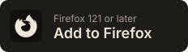
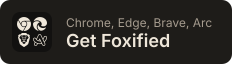

<p align="center">
  
</p>

<p align="center">
  A browser extension that sends the YouTube video you're watching to the <a href="https://github.com/kitsupanic/Grapplehook">Grapplehook</a> desktop app. Firefox and Chromium, Manifest V3.
</p>

<p align="center">
  <a href="https://addons.mozilla.org/addon/grapplehook/"><b>Add to Firefox</b></a> ·
  <a href="#install">Install</a> ·
  <a href="#privacy">Privacy</a> ·
  <a href="#nothing-happened">Nothing happened?</a> ·
  <a href="#development">Development</a> ·
  <a href="LICENSE">MIT license</a>
</p>

<p align="center">
  
</p>

## What it does

It skips the copy and paste. Pick a quality, and Grapplehook opens with that video ready to download. The Extension never downloads anything itself.

- **Under the video,** next to Like and Share. Click the hook to send at the quality it shows, or open its arrow to pick one: picking sends right away and becomes the new default.
- **On YouTube Music,** in the player bar next to Like, Dislike and ⋮ (it sends the track that's playing, whichever page you're on), and on each row of a song list when you hover it (artist pages, albums, playlists, search).
- **On any video link,** right-click and choose **Send to Grapplehook**. It uses the quality you last picked in the popup (Best if you haven't picked one).
- **From the toolbar,** on a video page: pick a quality and press **Send to Grapplehook**. On pages that aren't a single video, the button is greyed out.

> [!NOTE]
> It needs [Grapplehook](https://github.com/kitsupanic/Grapplehook/releases/latest) 0.3.0 or later on your computer. The Extension only hands it the link.

## Install

<p>
  <a href="https://addons.mozilla.org/addon/grapplehook/"></a>
  <a href="https://chromewebstore.google.com/detail/foxified/cldmemdnllncchfahbcnjijheaolemfk"></a>
</p>

**Firefox 121 or later:** get it from [Firefox Add-ons](https://addons.mozilla.org/addon/grapplehook/).

**Chrome, Edge, Brave or Arc:** add [Foxified](https://chromewebstore.google.com/detail/foxified/cldmemdnllncchfahbcnjijheaolemfk) first. It's a free extension that runs Firefox add-ons. Then open [Grapplehook on Firefox Add-ons](https://addons.mozilla.org/addon/grapplehook/) and add it through Foxified. Rather not use Foxified? [Load it by hand](#load-it-by-hand).

## Privacy

The Extension collects no data and sends nothing anywhere.

| It reads | It keeps | It hands over |
| --- | --- | --- |
| The address of YouTube and YouTube Music pages, to build the link | Your last picked quality, in the browser's own extension storage | The link, to Grapplehook on your computer |

It has no access to sites other than YouTube and YouTube Music.

## Nothing happened?

If **Send** does nothing or the browser shows an error, Grapplehook is probably missing or older than 0.3.0. The popup's **Nothing happened?** link opens a help page with a download link; the same page opens once when you first install the Extension.

<details>
<summary>How it talks to the app</summary>

<br>

The Extension opens a link that the operating system hands to Grapplehook:

```text
grapplehook://open?url=<video>&quality=<best|audio|height>
```

Grapplehook starts, or the copy already running gets the link. The format is a public contract: the app never renames or removes a field, so older versions of the Extension keep working. See [ADR 0003](https://github.com/kitsupanic/Grapplehook/blob/main/docs/adr/0003-extension-talks-through-a-deep-link.md) in the app's repo.

</details>

## Development

### Load it by hand

For development, or to skip Foxified on a Chromium browser.

- **Chrome, Edge, Brave, Arc:** open `chrome://extensions` (or `edge://extensions`), turn on **Developer mode**, click **Load unpacked** and pick this folder.
- **Firefox:** open `about:debugging#/runtime/this-firefox`, click **Load Temporary Add-on…** and pick `manifest.json` in this folder. Temporary add-ons are removed when Firefox quits.

### Run the tests

Needs Node 20 or later. No install step.

```bash
npm test
```

### Build the store zip

```bash
npm run build
```

This writes `dist/grapplehook-extension-<version>.zip` with only what the browser needs (`manifest.json`, `src/`, `icons/`, `LICENSE`). The same zip goes to the Chrome Web Store and Firefox Add-ons: Chrome reads `background.service_worker`, Firefox reads `background.scripts`. Bump `version` in `manifest.json` before each upload, since both stores refuse a version they've already seen.

### Layout

- `src/sendLink.js`: turns a page address into the `grapplehook://` link, or nothing if it isn't one video.
- `src/youtubeButton.js`: the hook buttons on YouTube and YouTube Music.
- `src/background.js`: opens the link for the hook buttons and the right-click menu; opens the help page on first install.
- `src/popup.html`, `src/popup.js`: the toolbar popup.
- `src/help.html`: the **Nothing happened?** page.

## License

[MIT](LICENSE). Barlow Condensed, used in the popup and help page, is under the [SIL Open Font License](src/fonts/OFL.txt).
